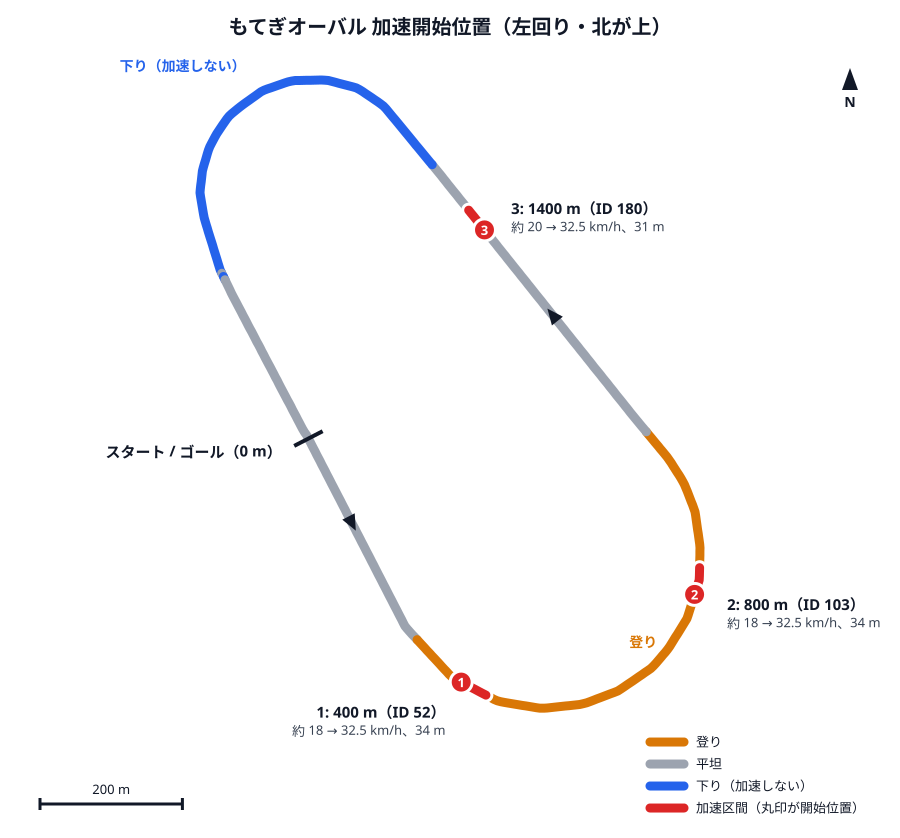

# もてぎ全国大会 2026 走行戦略（完走優先・低燃費）

本田宗一郎杯 Honda エコ マイレッジ チャレンジ 2026 第45回 全国大会（10/24 練習走行、10/25 決勝、CNグループⅣ）の走り方をまとめる。  
数値は [tools/strategy_sim.py](../tools/strategy_sim.py) の出力で、パラメータは [tools/strategy/motegi_2026.json](../tools/strategy/motegi_2026.json) にある。  
**現行仕様の実走データが無い状態で作った暫定版**なので、10/24 の練習走行で測り直して再計算する（[練習走行でやること](#練習走行1024でやること)）。  
10/18 に、2022 年全国大会の別チーム（No.180）の車載動画を使ってコースの勾配と発進・ゴールの位置を直した（[勾配](#勾配)・[発進とゴールの位置](#発進とゴールの位置)）。  
10/24 のコースウォークで発進・ゴールの位置と走るラインを確かめた（数値の変更なし）。コース上のコントロールラインは ID 1 ではなく 2,223 m にあるので、ロガーの周回ラインと区別する（[コース](#コース)）。

## 方針

規定時間： 39分20秒11 （2360.11 秒 平均時速 25 km/h） に対し、  
**目標完走時間： 37分25秒 （2245 秒 公式距離での平均時速 26.3 km/h） でタイムオーバーを回避しつつ燃費を稼ぐ。**

## 結論

- **1 周に 3 回、毎周同じ場所で加速を始め、32.5 km/h でエンジンを止める。**
- 加速を始める場所は、ID 1 から **400 m・800 m・1,400 m**。下り（1,590〜2,110 m）では加速しない。
- 発進は 160 m 先の内側レーン、ゴールは最終周の 2,000 m 付近で内側へ分かれた先の 2,224 m。**実際に走る距離は 7 周より約 280 m 短い。**
- 周回は約 5分21秒。合計の目標は **37分25秒**（規定 39分20秒11 まで約 115 秒）。
- **ロガーの周回数が増えるたびに走行時間を目標と比べ、遅れていたら加速停止速度を上げる。** これをやらないと完走できない場合がある（理由は[ペース管理](#ペース管理)）。
- 加速は発進を含めて 21 回。再始動に 1 回失敗しても約 1 秒しか失わないので、落ち着いてボタンを押し直す。

## 規則と制約

2026 年競技規則（2026年6月5日改訂版）第2章第1条より。

| 項目 | 内容 |
| --- | --- |
| 周回・距離 | 7 周、16,389.68 m（1 周 2,341.38 m） |
| 規定時間 | 39分20秒11（平均 25 km/h）。規定時間内にゴールできないと失格 |
| 計時 | スタートラインの 2 m 先の計測ラインから、ゴールライン通過まで |
| スタート | フラッグが振り上げられてから 10 秒以内に発進。できなければ再スタート（1 回限り） |
| 走行範囲 | コース内側平均 7 m 以内。低速車は左側 |
| ゴール後 | エンジンを切って惰行でよいが、後続に追突されないよう途中で止まらない |
| 暖機 | 燃料微調整を終えたあとはエンジン暖機禁止 |

各種お知らせ（公-6-2026「走行について」）では、発進した車は本コースへ合流し、ゴールへ向かう車は分岐地点でゴール側へ分かれる。分岐の手前では無理な追い越しをしない。

## コース

[tools/strategy/motegi_waypoint.csv](../tools/strategy/motegi_waypoint.csv)（ロガーの `sd/motegi_waypoint.csv` と同じもの）から読み取った。左回り。  
距離はウェイポイント ID 1 からで、公式の 1 周 2,341.38 m に合わせて伸縮してある。線が 3 本あるので混同しないこと。

- **コース上のコントロールライン**（白線）: 2,223 m。ゴールラインと同じ並び
- **ロガーの周回ライン**: 約 2,335 m（ID 300 と 1 のあいだ）。ロガーの周回数はここで増える。コース上のコントロールラインの約 110 m 先（26 km/h で約 15 秒後）
- **距離の基準**: ウェイポイント ID 1（0 m）。ロガーの周回ラインの約 7 m 先

この戦略書の「周回」「通過」は、断りがなければロガーの周回ラインを指す。

走るラインは内側の白線から 1.8〜2.4 m（10/24 のコースウォークで歩測。歩幅 0.6 m で 3〜4 歩）。白線からバンクの始まりまでは直線で 5.4〜8.4 m、カーブで 4.2〜4.8 m。ID はロガーのモード 2（標高グラフ）で使うウェイポイント番号。  
標高は GPS 1 回分の値を、惰行の減速度と別の GPS の周平均から推定し直したもの（[勾配](#勾配)）。

| 区間 | 距離 m | ID | 形 | 勾配 |
| --- | --- | --- | --- | --- |
| スタート直線 | 0〜260 | 1〜34 | 直線 | ほぼ平坦（標高 153.6 → 153.9 m） |
| 1 つ目のカーブ | 260〜1,020 | 35〜130 | 左へ約 190° | **登り**（+2.2 m、平均 0.29%） |
| バックストレート | 1,020〜1,590 | 131〜203 | 直線 | ほぼ平坦（最高点 156.1 m） |
| 2 つ目のカーブ | 1,590〜2,110 | 204〜270 | 左へ約 165° | **下り**（−2.2 m、平均 0.42%） |
| 戻りの直線 | 2,110〜2,341 | 271〜300 | 直線 | ほぼ平坦 |

| 場所 | 距離 m | 内容 |
| --- | --- | --- |
| 発進 | 160 | スタート直線の内側の発進レーン（周回路の約 20 m 内側）。計測ラインは約 165 m。345 m 付近（ID 45）で本コースへの合流が終わる |
| コース上のコントロールライン | 2,223 | 本コースを横切る白線。ゴールラインの横 |
| ロガーの周回ライン | 約 2,335 | ロガーの周回数が増える線。本コースから発進・ゴールのレーン、ピット側まで横切っている。1 周目は発進からなので約 2,170 m |
| ゴールへの分岐 | 約 2,000 | 最終周だけ、2 つ目のカーブの出口で左（内側）のゴールレーンへ入る |
| ゴールライン | 2,224 | ゴールレーンの「GOAL」の看板の下。7 周目は ID 1 の約 117 m 手前で終わる |

## 走行パターン

### 定常周回（2〜6 周目）

| 加速開始 | ID | 場所の目安 | 加速開始時の速度 | 加速時間 |
| --- | --- | --- | --- | --- |
| 400 m | 52 | 1 つ目のカーブに入って約 140 m | 約 18 km/h | 約 5 秒 |
| 800 m | 103 | 1 つ目のカーブの出口の約 220 m 手前 | 約 19 km/h | 約 5 秒 |
| 1,400 m | 180 | バックストレートの後半（2 つ目のカーブの約 190 m 手前） | 約 20 km/h | 約 5 秒 |

- どの加速も **32.5 km/h に達したらエンジンを止める**。34 km/h（4,000 rpm）以上は回さない（[根拠](#34-kmh-以上を使わない理由)）。
- 1,400 m の加速のあとは、下りと 2 本の直線を惰行で抜ける。ロガーの周回ラインの通過は約 26 km/h。
- 周回中の速度は 18〜33 km/h。
- **最低限界速度**: 目印の手前でも 16 km/h まで落ちたら、その場で加速する。

### 加速開始位置の地図



- 丸印が加速を始める場所、赤い線が加速している区間（定常周回の計算値）。点線は内側のレーンにある発進とゴールの位置。ロガーの周回ラインは 0 m の線の約 7 m 手前。コース上のコントロールラインはゴールの点線の横（2,223 m）。
- コースの色は勾配。標高の細かな波を除くため、前後 150 m の平均で塗り分けてある。
- 加速はクランキングの分だけ遅れ、目印の約 4 m 先から始まる。

| 番号 | 位置 | ID | 緯度, 経度 | 加速区間 | 地図 |
| --- | --- | --- | --- | --- | --- |
| 1 | 400 m | 52 | 36.529680, 140.228725 | 404〜437 m（33 m） | [Google マップ](https://www.google.com/maps?q=36.529680,140.228725) |
| 2 | 800 m | 103 | 36.530787, 140.232390 | 804〜838 m（34 m） | [Google マップ](https://www.google.com/maps?q=36.530787,140.232390) |
| 3 | 1,400 m | 180 | 36.535386, 140.229090 | 1,404〜1,435 m（31 m） | [Google マップ](https://www.google.com/maps?q=36.535386,140.229090) |

緯度経度はウェイポイントを結んだ線上の値で、実際の走行ラインとは数 m ずれる。  
加速の合図はロガーが GPS の位置で出すので、目印はその補助。10/24 のコースウォークは雨で写真を撮れなかったため、下の動画の目印で覚えておき、練習走行で実物を確かめる。

2022 年の No.180 の車載動画で、各位置を通過した瞬間に見えていたもの。パラソル・コーン・テントは当日の設置物なので、2026 年も同じ場所にあるとは限らない。  
画像は OneDrive の `Chibi-T/20261025_全国大会CN燃料/動画目印_No180/` にある（別チームの映像なのでリポジトリには入れない）。

| 位置 | 見えるもの（2022 年） |
| --- | --- |
| 200 m | 左（内側）に白い三角屋根のテントが並び、手前に赤白のバリアとコーン |
| 350 m | 1 つ目のカーブの入口。左の白い壁が終わる少し手前 |
| 400 m | 左の白い壁の切れ目を過ぎたところ。前方の内側の芝に緑白のパラソルの監視ポスト |
| 600 m | 内側の芝の緑白のパラソルと白い小屋の真横 |
| 800 m | カーブの奥。内側の芝に監視ポスト、外側はスタンド |
| 1,000〜1,100 m | バックストレートの入口。左にオレンジのコーンの列、路面に黄色の破線 |
| 1,400 m | バックストレート後半。前方左に黒いテントと緑白のパラソル、手前にオレンジのコーン |
| 2,000 m | 最終周のみ: 左の壁の切れ目からゴールレーンへ入る |

位置を変えたときは次のコマンドで描き直す。

```sh
python3 tools/strategy_sim.py map --marks 400 800 1400 --v-off 32.5 --out document/motegi_strategy_2026_map.svg
```

### スタート（1 周目）

1. フラッグが上がったら始動して全開。**32.5 km/h で止める**（計算上は約 8 秒、約 44 m。発進レーンの 204 m 付近）。合流は周回車に注意して、コースに沿って緩やかに（合流が終わるのは 345 m 付近）。
2. 400 m の通過は約 29 km/h。停止速度まで 2 km/h 以上足りないので、合図どおり短く加速する。合流が終わった直後なので、周回車がいれば無理に加速しない（次の 800 m で取り返せる）。
3. 800 m・1,400 m は定常周回と同じ。1 周目のロガーの周回ライン通過は約 4分46秒。

### 最終周（7 周目）

- 400 m と 800 m で加速したら、**あとは惰行でゴール**する（800 m の加速後からゴールまで約 1,390 m、ゴール通過は約 20 km/h）。最終周（6 周目の通過からゴールまで）は約 5分55秒。
- 2,000 m 付近の分岐でゴールレーンへ入る。分岐の手前では追い越さない。
- ただし **6 周通過時の走行時間が 33分00秒（1,980 秒）を超えていたら、1,400 m でも加速する**。惰行で終えると規定時間までの余裕が 15 秒を切るため。

## ペース管理

加速停止速度が全周で 0.5 km/h 高いだけで合計は約 40 秒縮み、走行抵抗が 20% 大きいだけで約 70 秒延びる。  
速度計の誤差や路面・風でこの程度はずれるので、**決めた速度で走るだけでは、抵抗が大きく速度計が低めに出た場合に規定時間を超える**（下の表の最終行）。  
ロガーの周回数が増えるたびに、ロガー（モード 0）の走行時間を下の表と比べる。コース上のコントロールライン（白線）ではまだ増えない（約 110 m 先で増える）。

| 通過 | 目標 | 秒 | +1 km/h にする | +2 km/h にする | +3 km/h にする |
| --- | --- | --- | --- | --- | --- |
| 1 周 | 4:46 | 286 | 4:54 以降 | 5:06 以降 | 5:21 以降 |
| 2 周 | 10:07 | 607 | 10:15 以降 | 10:27 以降 | 10:42 以降 |
| 3 周 | 15:28 | 928 | 15:36 以降 | 15:48 以降 | 16:03 以降 |
| 4 周 | 20:49 | 1,249 | 20:57 以降 | 21:09 以降 | 21:24 以降 |
| 5 周 | 26:10 | 1,570 | 26:18 以降 | 26:30 以降 | 26:45 以降 |
| 6 周 | 31:31 | 1,891 | 31:39 以降 | 31:51 以降 | 32:06 以降 |
| ゴール | 37:25 | 2,245 | — | — | — |

- 1 周目は発進が 160 m 先なので、ほかの周より約 35 秒短い。
- 「+1 km/h」は、次の 1 周の加速停止速度を 32.5 → 33.5 km/h にする意味。+1 km/h で 1 周あたり約 11 秒縮む。
- 30 秒以上早ければ加速停止速度を 0.5 km/h 下げてよい。
- 補正は毎周やり直す（遅れが消えたら 32.5 km/h に戻す）。
- ロガーの走行時間は初回始動からの秒数なので、公式計時より 1〜2 秒進んでいる（安全側）。

この補正を入れたシミュレーション結果（加速開始位置を ±30 m ずらした 3 通りの最長）:

| 条件 | 補正なし | 補正あり | 規定まで |
| --- | --- | --- | --- |
| 基準 | 37:44 | 37:30 | +110 秒 |
| 走行抵抗 +20% | 38:54 | 38:05 | +75 秒 |
| 走行抵抗 −20% | 35:18 | 35:41 | +219 秒 |
| 再始動失敗 3 回 | 37:44 | 37:30 | +110 秒 |
| 走行抵抗 +20%、再始動失敗 3 回 | 38:54 | 38:06 | +74 秒 |
| 走行抵抗 +20%、加速力が最も弱い想定 | 38:32 | 37:55 | +85 秒 |
| 加速停止速度が 1 km/h 低い | 38:55 | 37:48 | +92 秒 |
| 加速停止速度が 1 km/h 低く、走行抵抗 +20% | 39:59（失格） | 38:24 | +56 秒 |

## トラブル時の対応

| 状況 | 対応 |
| --- | --- |
| 再始動でエンジンがかからない | スタータは 1 秒で自動的に止まる。**ボタンを一度離して押し直す**（押しっぱなしでは再クランキングしない）。3 回失敗しても合計の遅れは数秒 |
| 何度押してもかからない | 惰行を続けながらキルスイッチを OFF → ON してから押し直す。16 km/h を切る前に左（内側）へ寄る |
| 加速しても速度が伸びない | 32.5 km/h の手前で頭打ちなら燃圧低下の可能性。無理に引っ張らず **30 km/h で止め、200 m・600 m・1,000 m・1,400 m の 4 回加速**に切り替える（計算上の合計は 37:42〜38:04、加速 27 回） |
| 目印を見落とした | 気づいた時点で加速する。次の目印からは元に戻す |
| 遅い車に詰まった | 加速を前倒しして抜く。その周の通過タイムで補正する |

## 完走リスクのチェックリスト

- [ ] **ロータリーエンコーダマグネットの固定**。2025 年全国大会は走行中のマグネットの脱落でクランク角が取れなくなりリタイアした。脱落防止と固定を確認する
- [ ] **始動の成功率**。9/26 のドラムでは 15 回中 3 回失敗（9/19 は 29 回中 15 回）
  - 1 回は初爆して回転が上がった直後に 1 秒のタイムアウトで止められたもの。10/4 のファーム修正（初爆後はスタータだけ止めて運転を続ける）で対処済みだが、**実車では未確認**
  - 残り 2 回は約 0.7 秒クランキングしても初爆しなかったもの。原因は未特定
- [ ] **加速中の燃圧**。9/26 のドラムでは 15 秒を超える加速で 0.32 → 0.22 MPa まで下がり、その間は速度が伸びなかった。加速開始から 6 秒以内は 11 本すべて 0.317 MPa 以上だった。本戦略の加速は約 5 秒（発進のみ約 8 秒）
- [ ] **バッテリー**。スタータを 21 回以上回す。2024 年本番（22 回）と同等
- [ ] **速度計の誤差**。タイヤ周長（`PERIMETER_MM` = 1548）が 1% ずれると速度が 0.3 km/h ずれ、合計で約 25 秒変わる
- [ ] ロガーのモード 0 で走行時間と速度が読めること、モード 2 で現在位置の ID が読めること
- [x] **発進・ゴールの位置**。10/24 のコースウォークで、発進 158.5〜159.5 m・ゴール 2,223〜2,225.5 m（想定 160 m・2,224 m）を確認した
- [ ] **ロガーの周回ライン**。コースウォークでは ID 300 と 1 のあいだ（2,331〜2,335 m）で周回数が増えた。練習走行でも増える位置を確かめる

## 根拠

### 走行抵抗

2024 年本番（`LOG0369`）と 2025 年本番（`LOG0503`）の惰行 65 区間から、勾配を差し引いて最小二乗で求めた（標高は[推定し直したもの](#勾配)）。

| | Crr | k = 0.5ρCdA/m |
| --- | --- | --- |
| 2024 年 | 0.00227 | 0.000290 /m |
| 2025 年 | 0.00061 | 0.000528 /m |
| 全体（採用） | 0.00164 | 0.000384 /m |

- 25 km/h での減速度は 0.035 m/s²（平坦）。
- 年ごとの係数は割れているが（速度の記録が 1 km/h 刻みで、転がりと空気を分けきれない）、合計の抵抗は近い。全体の係数で各年の惰行を計算し直すと、所要時間の誤差は 2024 年 +1.1%、2025 年 +2.2%、終速の誤差は RMS 1.2〜1.6 km/h。
- 片方の年で合わせた係数でもう片方を予測しても、所要時間の誤差は +0.1%〜+2.7%。
- 上の感度表の「走行抵抗 ±20%」はこの不確かさと当日の風を見込んだもの。

### 勾配

ウェイポイントの標高は GPS 1 回分の値で、細かく波打っていた。勾配（0.3〜0.4%）は転がり抵抗（Crr 0.0016）より大きいので、標高の誤差は走行抵抗の推定と戦略の両方をずらす。  
次の 3 つをまとめて最小二乗で解き、50 m ごとの標高を推定し直した（`fit-grade`）。

- 自チーム 2024・2025 本番の惰行 65 区間（減速度から勾配が分かる）
- 2022 年全国大会の No.180（東京都市大学付属中高 自動車部、別チーム）の[車載動画](https://www.youtube.com/watch?v=0ExUi3rCDqU)の速度表示から読み取った惰行 31 区間
- 同じ動画の GPS 標高を 6 周重ねた平均（周ごとのばらつき σ 0.25 m）

| 区間 | 元の標高差 | 推定し直した標高差 |
| --- | --- | --- |
| 1 つ目のカーブ（260〜1,020 m） | +2.44 m | +2.17 m |
| 2 つ目のカーブ（1,590〜2,110 m） | −2.33 m | −2.17 m |
| 1 周の高低差 | 2.91 m | 2.55 m |

- 元の標高との差は最大 0.25 m（RMS 0.13 m）。正面の直線が約 0.2 m 高く、バックストレート側が約 0.15 m 低くなった。
- 惰行の当てはまりは、全体の残差 2.74 → 2.37 J/kg、終速の RMS 誤差 2024 年 1.9 → 1.6 km/h・2025 年 1.9 → 1.2 km/h。
- そのログを使わずに推定した標高でそのログを再現しても、所要時間の誤差は 2024 年 +1.4% → +1.4%、2025 年 +1.8% → +1.2%、No.180 −0.4% → −0.1% と悪化しなかった。
- 同じパターン・同じ係数で比べると、合計は約 15 秒延びる。
- 動画の読み取り方法と中間データは OneDrive の `Chibi-T/20261025_全国大会CN燃料/動画解析_No180/` にある。
- 10/24 のコースウォークの気圧（`LOG0000_コースウォーク.CSV`）でも確かめたが、標高は差し替えていない。雨で気圧が数分のうちに数 Pa（標高 0.3 m 前後）動いており、1 周を通した高低差は 4.4 m と、惰行と GPS から求めた値（2.4〜2.9 m）より大きく出たため。数分以内の比較では、走行ライン上の 345〜470 m（ID 45〜61）は約 0.5 m のなだらかな登りで、ID 41〜51 にくぼみは見えなかった。周回路は横方向にも傾いていて、横位置が 10 m 違うと標高が約 0.5 m 違う。

### 発進とゴールの位置

これまでは「コントロールラインから発進し、7 周してコントロールラインでゴール」として計算していたが、実際はどちらも周回路の内側の別レーンにある。

- No.180 の動画: コース図の現在位置をウェイポイントに当てはめると（ずれは中央値 2 m）、発進は ID 1 の 160 m 先、ゴールは 7 周目の 2,224 m（2,000 m 付近で内側へ分岐）。発進からゴール通過までの動画上の時間 2,353.4 秒は公式記録 39:13.090 と一致した。
- 自チームの 2024・2025 本番ログでも、発進前に待っていた位置は 150〜157 m・周回路の約 20 m 内側で、No.180 と合う。
- 実際に走る距離は、コース距離に直して 16,112 m（公式距離より約 280 m 短い）。合計時間は約 45 秒短くなる。規定時間は公式距離から決まるので変わらない。
- ロガーは周回を自分の周回ライン（ID 1 の約 7 m 手前）で数えるので、1 周目は約 2,170 m、7 周目は約 2,230 m になる。通過タイムの表とロガーの設定ファイルはこれを織り込んである。
- シミュレータは ID 1 の通過を周回の通過として数えるので、ロガーの通過はシミュレータより約 1 秒早い。補正の判定（8 秒）に比べて小さいので、表はそのまま使う。
- パラメータは `course.start_m` = 160、`course.finish_m` = 2224。
- 10/24 のコースウォーク（ロガーで記録したまま歩いた）の結果。各線の両端に立ったときの位置で、GPS のずれは数 m ある。

| 場所 | 距離 m | 周回路の中心線からの横位置 |
| --- | --- | --- |
| スタートライン | 158.5〜159.5 | 内側 14〜21 m |
| 計測ライン | 165〜167 | 内側 17〜20 m |
| 本コースへの合流が終わる所 | 345 | 内側 5 m |
| ゴールレーンへの分岐 | 1,990 | ほぼ中心線上 |
| コース上のコントロールライン | 2,222.5〜2,224.5 | 本コース上 |
| ゴールライン | 2,223〜2,225.5 | 内側 20〜21 m |
| ロガーの周回数が増えた位置（5 回） | 2,331〜2,335 | 内側 18 m・外側 11 m・ピット側 64 m など |

- コース上のコントロールラインとゴールラインは同じ並びにある。公式の 7 周は「発進 → コントロールラインを 6 回通過 → 7 回目にゴールレーンのゴールライン」で、上の走行距離（16,112 m）と合う。
- ロガーの周回ラインはピット側まで横切っているので、ピットやパドックを動いたときにも周回数が増える。発進時に周回数を 0 に戻すので走行中の数には影響しないが、ゴール後にも増えることがある。

### 2022 年 No.180 の走り（参考）

- 7 周 39:13.090（規定まで 7 秒）。ID 1 の通過間の周回は 5:34〜6:08。
- 1 周 3 回、約 17 km/h から 34〜36 km/h まで加速。加速開始は 520〜700 m、940〜1,100 m、2,180〜2,320 m 付近。
- 惰行の減速度は 25 km/h で約 0.05 m/s² と、自チーム（0.035 m/s²）より大きい。
- 周回中は正面の直線でウェイポイントの線より約 8 m 内側を走っていた。

### 加速力と燃料

9/26 のドラム（慣性 105 kg 相当、`LOG0645`）から求めた。

| 速度帯 km/h | ドラム加速度 m/s² | 燃料 ml/s | 最低燃圧 MPa |
| --- | --- | --- | --- |
| 10 | 1.19 | 0.057 | 0.319 |
| 18 | 1.06 | 0.059 | 0.317 |
| 22 | 0.97 | 0.062 | 0.314 |
| 26 | 0.67 | 0.068 | 0.315 |
| 30 | 0.51 | 0.073 | 0.312 |
| 34 | 0.28 | 0.077 | 0.282 |
| 38 | 0.17 | 0.080 | 0.221 |
| 42 | 0.08 | 0.080 | 0.279 |

- ドラム上の惰行減速度は 0.50 m/s²（速度によらずほぼ一定）で、実走（0.035 m/s²）の約 14 倍。ドラム自体の損失が大きい。
- 実走の加速度は「ドラム加速度 + ドラム損失の一部 − 走行抵抗」とし、損失の上乗せ率は 0.5 を基準にした。**この上乗せ率は実走でしか決められない。**
- 上乗せ率を 0〜1 に振ると、7 周の燃料（ECU 積算値相当）は 5.7〜10.0 ml と変わるが、加速位置と加速停止速度の結論は変わらない。
- 上乗せ率 1 だと車輪の仕事が燃料 1 ml あたり 12〜15 kJ になり、エンジンとしては高すぎる。ECU の燃料積算が実消費より少なく出ている可能性がある。**燃費の絶対値はこの戦略書からは読めない。**

### 34 km/h 以上を使わない理由

- 加速度が 30 km/h の 0.51 から 34 km/h で 0.28、38 km/h で 0.17 m/s² へ落ちる一方、燃料流量は増える。同じ燃料で得られる加速が半分以下になる。
- 4,000 rpm 以上は MAP の噴射時間が短く（2.4〜2.7 ms）、燃圧も下がる。

### 加速回数の選び方

| 1 周の加速回数 | 加速開始位置 m | 加速停止速度 | 合計 | 燃料（ECU 積算値相当） | 加速回数 |
| --- | --- | --- | --- | --- | --- |
| 2 回 | 100, 800 | 36.5 km/h | 37:06〜37:45 | 7.92 ml | 14 回 |
| **3 回** | **400, 800, 1,400** | **32.5 km/h** | **37:09〜37:44** | **7.17 ml** | **21 回** |
| 4 回 | 200, 600, 900, 1,400 | 30.0 km/h | 37:38〜38:11 | 6.78 ml | 27 回 |
| 5 回 | 0, 300, 500, 700, 2,100 | 36.0 km/h | 36:31〜38:15 | 9.90 ml | 33 回 |

- 2 回だと 36.5 km/h まで引っ張る必要があり、効率の悪い回転域と燃圧低下の領域を使う。
- 燃料最小は 4 回で、3 回より 5.4% 少ない。ただし再始動が 6 回増え、差はモデルの燃料の不確かさ（約 6%）と同程度なので 3 回を採る（パラメータの `fuel_slack` = 0.06）。
- 3 回は 32.5 km/h より下げると周回中の最低速度が 17 km/h を割るので、時間の余裕を燃料に回しきれない。練習走行の結果で 4 回のほうが良ければ切り替える。

### 速度だけで判断する方法を採らなかった理由

「20 km/h まで落ちたら加速、32 km/h で止める」方式（2024 年の走り方）も計算した（`speed-rule` サブコマンド）。  

- 燃料最小は「22 km/h で加速開始、29 km/h で停止」の 6.97 ml だが、加速が 38 回になる（推奨より 17 回多い）。
- 加速を 25 回に抑えた「21 km/h で加速開始、32 km/h で加速停止」は 7.27 ml で推奨とほぼ同じ。加速位置が周ごとにずれるので、通過タイムでの補正がしにくい。
- 加速開始速度を ±0.5 km/h ずらしたときの合計時間の振れは、全組の平均で 83 秒。推奨パターンは加速開始位置を ±30 m ずらして 35 秒。

## 練習走行（10/24）でやること

測るもの。優先順。

1. **惰行**: エンジンを止めて 35 → 18 km/h まで惰行を 2 本以上（場所はどこでもよい。勾配は計算で差し引く）
2. **全開加速**: 20 → 34 km/h を 3 本以上。バックストレート（平坦）で行う
3. **発進加速**: 0 → 33 km/h を 1 本
4. **再始動**: 走行中の再始動を 10 回以上行い、成功数を数える
5. **推奨パターンの通し**: 400 m・800 m・1,400 m で加速、32.5 km/h で停止を 3 周以上。周回タイムが 5分21秒前後になるか確認する
6. **燃料**: 走行前後の燃料重量を量り、ECU 積算値と比べる。体積は 重量 ÷ 密度（規則 第2章第1条）
7. **発進とゴールの位置**: ロガーのログで、発進した位置とゴールを通過した位置（ID）を確かめる

### 7 周の進め方

練習走行は本番と同じ手順で 7 周を 1 本だけ走る（公式通知Ⅱ）。この 1 本に上の項目をすべて入れる。  
**1〜3 周目は測定用のパターン、4 周目からは推奨パターン**で走り、どちらもロガーの走行支援画面の合図に従う。  
プランは [tools/strategy/practice_motegi_2026.json](../tools/strategy/practice_motegi_2026.json) にある。

| 周 | パターン | 加速開始位置（加速開始時の速度） | 加速停止速度 | 所要 | 累積 |
| --- | --- | --- | --- | --- | --- |
| 1 | 測定 | 発進（160 m）、350 m（33 km/h）、600 m（28 km/h）、1,100 m（20 km/h） | 35.0 km/h | 4:33 | 4:33 |
| 2・3 | 測定 | 350 m（17 km/h）、600 m（29 km/h）、1,100 m（20 km/h） | 35.0 km/h | 5:13 | 9:47、15:00 |
| 4 | 推奨 | 400 m（16 km/h）、800 m（19 km/h）、1,400 m（20 km/h） | 32.5 km/h | 5:28 | 20:28 |
| 5・6 | 推奨 | 400 m（18 km/h）、800 m（19 km/h）、1,400 m（20 km/h） | 32.5 km/h | 5:21 | 25:50、31:10 |
| 7 | 推奨 | 400 m、800 m。あとは惰行でゴール | 32.5 km/h | 5:55 | 37:05 |

- 測定用パターンの 1,100 m がバックストレートの全開加速、350 m が長い惰行（1,100 m の加速後から約 1,550 m）の終わり。600 m は、バックストレートに 20 km/h 前後で入るための継ぎ足し。
- 合計は 37分05秒（規定まで約 135 秒）。走行抵抗 +20% や加速停止速度 −1 km/h を重ねても、通過タイムの補正込みで規定まで 77 秒以上残る。

ロガーの操作。

1. 練習用の設定ファイルを `motegi_strategy.json` の名前で microSD に入れる。発進前の画面が「茂木 3回」「停止 35.0」になっていることを確かめる。
2. 1〜3 周目は合図どおりに走る。
3. **ロガーの周回数が 4 周目に変わったあと、400 m までに B ボタンを長押し（1 秒）する。** 状態行が「3回予備」、停止が 32.5 に変われば推奨パターンになっている。
4. 4〜7 周目は合図どおりに走る。7 周目は本番と同じで、800 m の加速のあと「惰行でゴール」が出る。

- 通過タイムの目標もこのプランに合わせてある。測定の周でも 8 秒を超えて遅れると加速停止速度が上がる（表示に従ってよい）。
- 4 周目の 400 m は 16 km/h 近くまで落ちるので、目印より少し手前で「加速! 速度低下」が出ることがある。
- ロガーが再起動すると測定用パターンに戻る。4 周目以降なら B ボタンを長押しし直す。
- 測定の周で燃圧低下の警告が出たら、3 周を待たずに B 長押しで推奨パターンへ切り替えてよい。
- **決勝の前に、microSD の設定ファイルを本番用に入れ替える**（下の再計算で作り直したもの）。

各項目が取れる場所。

| 項目 | 取れる場所 | 本数 |
| --- | --- | --- |
| 1 惰行 | 1〜3 周目の 1,100 m の加速後 → 次の周の 350 m（3 周目は 4 周目の 400 m まで）。35 → 18 km/h 以下 | 3 |
| 2 全開加速 | 1〜3 周目の 1,100 m。20 → 35 km/h、約 5 秒 | 3（ほかに 4〜6 周目の 1,400 m で 20 → 32.5 km/h が 3 本） |
| 3 発進加速 | 1 周目の発進。0 → 35 km/h、約 10 秒 | 1 |
| 4 再始動 | 全周 | 20 |
| 5 推奨パターンの通し | 4〜6 周目。7 周目は最終周の手順の確認 | 3 周 |
| 6 燃料 | 公式の走行前後の計量と ECU 積算値（計算上は 7.6 ml 相当） | — |
| 7 発進とゴールの位置 | 発進直後と 7 周目のゴール通過の ID・緯度経度 | 1 |

- 走行抵抗が計算より 20% 小さい場合は、惰行が 18 km/h まで落ちきらない（350 m で約 22 km/h）。

プランの確認と、ロガーの設定ファイルの作り方。

```sh
# 各周の所要・加速開始時の速度・感度
python3 tools/strategy_sim.py --params tools/strategy/practice_motegi_2026.json plan

# ロガーのリポジトリ（Chibi-T_Furoshiki_Logger）で実行する。本番用を上書きしないよう出力先を分ける
python3 tools/make_strategy_json.py motegi \
    --params ../UNOR4_Chibi-T_EFI/tools/strategy/practice_motegi_2026.json \
    --fuel-warn-mpa 0.30 --beep -o sd/motegi_strategy_practice.json
```

### 練習走行後の再計算

再計算の手順。

```sh
# 発進・ゴールの位置（コースウォークと練習走行のログで測った値）を
# tools/strategy/motegi_2026.json と practice_motegi_2026.json の course.start_m / finish_m に書く

# 標高（練習走行の惰行を足して推定し直す。No.180 のデータは OneDrive の 動画解析_No180/ にある）
python3 tools/strategy_sim.py fit-grade <2024本番.CSV> <2025本番.CSV> no180_log.csv <練習走行.CSV> \
    --alt-csv no180_alt.csv --out tools/strategy/motegi_waypoint.csv
# 標高を差し替えたら、ロガーの sd/motegi_waypoint.csv にも同じファイルを入れる

# 走行抵抗（練習走行のログを過去 2 年のログに足す）
python3 tools/strategy_sim.py fit-coast <2024本番.CSV> <2025本番.CSV> <練習走行.CSV>

# 惰行モデルの当てはまり確認
python3 tools/strategy_sim.py replay <練習走行.CSV>

# 出力の crr / k_aero を tools/strategy/motegi_2026.json の vehicle へ書き写してから
python3 tools/strategy_sim.py optimize
```

- 全開加速の所要時間がこの戦略書（20 → 32.5 km/h で約 5 秒）と違う場合は、`burn.drum_loss_fraction` を 0〜1 の範囲で動かして合わせる。遅ければ下げ、速ければ上げる。
- `optimize` が出す加速開始位置・加速停止速度・累積タイム表で、この戦略書の表と地図を差し替える。終了コードが 2 なら、補正を入れても規定時間を超える感度ケースがある。
- ロガーの設定ファイルは、ロガーのリポジトリで `python3 tools/make_strategy_json.py motegi` を実行して作り直す。

## 再現方法

```sh
python3 tools/strategy_sim.py fit-grade LOG0369.CSV LOG0503.CSV no180_log.csv --alt-csv no180_alt.csv   # 標高
python3 tools/strategy_sim.py fit-coast LOG0369.CSV LOG0503.CSV   # 走行抵抗
python3 tools/strategy_sim.py fit-burn LOG0645.CSV                # ドラムの加速度・燃料流量
python3 tools/strategy_sim.py optimize                            # 走行パターンと感度
python3 tools/strategy_sim.py speed-rule                          # 速度だけで判断する方式（比較用）
python3 tools/strategy_sim.py --params tools/strategy/practice_motegi_2026.json plan   # 練習走行のプラン
python3 tools/strategy_sim.py map --marks 400 800 1400 --v-off 32.5 --out document/motegi_strategy_2026_map.svg
python3 tools/test_strategy_sim.py                                # テスト（ログ不要）
```

走行ログは GPS 座標を含むためリポジトリには入れていない。No.180 の動画から読み取ったデータ（`no180_log.csv`・`no180_alt.csv`）も、別チームのものなのでリポジトリには入れていない。
