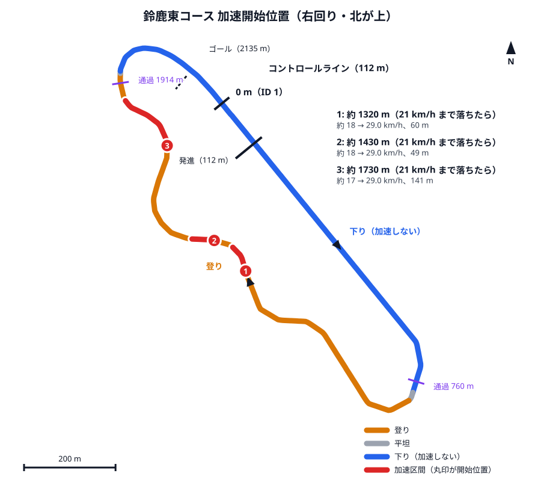

# 鈴鹿大会 2027 走行戦略（完走優先・低燃費）

Honda エコ マイレッジ チャレンジ 2027 鈴鹿大会（鈴鹿サーキット東コース、CN グループⅣ）の走り方をまとめる。  
数値は [tools/strategy_sim.py](../tools/strategy_sim.py) の出力で、パラメータは [tools/strategy/suzuka_2027.json](../tools/strategy/suzuka_2027.json) にある（乾いた路面が基準、雨は `--variant rain`）。  
材料は、自チームの 2024〜2026 年の鈴鹿のログと資料、2018〜2026 年の公式リザルト、他チームの車載動画 5 本、2026 年全国大会（もてぎ）の実走の較正。  
2027 年の競技規則と公式通知はまだ出ていない。周回数・規定時間・発進とゴールの位置は 2018〜2026 年と同じと仮定し、【要確認】と書いたところは、規則の発表とコースウォークで確かめる。

## 方針

**完走する。** 自チームは鈴鹿で一度も完走していない（2024 年は 4 周、2025 年は 6 周で止まった。2026 年は本番が中止）。止まったのはどちらも登りで、2025 年はパンク、2024 年は登りで力が足りなかった。  
燃費はそのあと。鈴鹿は高低差が約 34 m あり、もてぎ（2.5 m）とは走り方の組み立てが違う。

- 規定時間： 42分16秒70（2,536.7 秒、平均時速 25 km/h）に対し、**計画の合計は 26分26秒（乾いた路面）・29分43秒（雨）。規定まで 12〜16 分残る。**
- この余裕は燃料に換えられない（[時間の使い方がもてぎと違う理由](#時間の使い方がもてぎと違う理由)）。**タイムマネジメントの目的は、規定に収めることではなく、登りで止まる・スピンするといった事故で失う時間を見張ること**になる。
- ゆっくり走っても燃料は減らない。燃料を左右するのは、**頂上を越える速度と、下りでブレーキを踏む量**。

## 結論

- **加速を始める合図は速度だけ（位置の目印は使わない）。登りで 21 km/h まで落ちたら加速し、29 km/h で止める。**
  - 1 周に 3 回。おおよそ 1,315 m・1,420 m（S 字の登り）、1,725 m（ダンロップの登り）。下りの勢いが毎周違っても、速度で決めれば同じ所で始まる。
  - 位置で始める方式（もてぎの方式）は使えない。登りに入る速度が頂上の越え方で毎周変わり、目印で加速が飛ばされると、そのまま登りで止まる（[加速の合図に速度を使う理由](#加速の合図に速度を使う理由)）。
- **ダンロップの登り（1,700〜1,914 m、最大 7.4%）は、加速を始めたら頂上を越えるまでエンジンを止めない。** 全開でも 28 km/h ほどで頭打ちになり、29 km/h には届かない。
- **頂上（1,914 m）から 1・2 コーナーの先（1,000 m）までは加速しない。** 頂上を 20〜24 km/h で越えれば、下りの底（760 m）で自然に 72〜75 km/h まで出る。
  - **乾いた路面はブレーキを踏まない。** 2024 年本番は 74〜75 km/h でブレーキなしで 1・2 コーナーを抜けた。
  - **雨は 55 km/h に抑える（ブレーキ）。** 2025 年本番の 4 周目は、雨で 67 km/h で入って 948 m でスピンした。燃料は乾いた路面より約 36% 増える。
- 計画の合計は **乾いた路面 26:26（1 周 3:16）・燃料 21.7 ml、雨 29:43（1 周 3:43）・燃料 29.5 ml**（どちらも ECU 積算の尺度。実際の消費は約 1.44 倍で、乾いた路面なら 500〜570 km/L の見込み）。
- **一番の危険は、登りでの始動の失敗。** 7.4% のダンロップの登りでは 0.75 m/s² で減速し、21 km/h からでも約 8 秒で止まる。4.6% の S 字の登りでも、12 秒かかれば止まる。**失敗したら間を置かずに押し直す。** 止まったときの坂道発進は練習走行で確かめる（[トラブル時の対応](#トラブル時の対応)）。
- **発進・ゴール・コントロールラインは、路面の白線（ウェイポイント ID 1）とは別の場所にある。** 発進はピットレーンの 110 m、コントロールラインはそのスタートラインを外側へ延ばした本コース上（110 m）、ゴールは最終コーナーの出口で分かれるピット入口の道の 2,135 m。最終周はコントロールラインを通らずにゴールする。ロガーの線もここへ移した（[発進・ゴール・コントロールラインの位置](#発進ゴールコントロールラインの位置)）。【要確認】

## 規則と制約

2025 年・2026 年鈴鹿大会の競技規則（第2章）より。2018〜2026 年の公式リザルトでも、周回数・距離・規定時間は毎年同じだった。

| 項目 | 内容 |
| --- | --- |
| 周回・距離 | 8 周、17,616 m（1 周 2,202 m）。二輪車クラスは 5 周 |
| 規定時間 | 42分16秒70（平均 25 km/h）。規定時間内にゴールできないと失格。規定時間に達した車両は、その周回内にゴールする |
| 計時 | スタートラインの 2 m 先の計測ラインから、ゴールライン通過まで（トランスポンダ） |
| スタート | 1 台ずつ、停止状態から。フラッグが振り上げられてから 10 秒以内に発進。できない、または 20 m 先の「レッドライン」の手前で止まると再スタート（1 回限り） |
| 走行 | 低速で走る車両は右側。コースへの合流で他車を妨害しない |
| 停車 | 事故・故障で止まるときはコース外へ寄せる。ドライバーが独力で直せたときだけ復帰できる |
| ゴール後 | エンジンを切って惰行してよいが、途中で止まらず安全な速度でゴール後車検エリアへ |
| 練習走行 | 1 回の出走で連続 3 周以内。時間内なら複数回出走できる（初回の車両が優先） |

インフォメーション No.1（2026 年「走行時の心得について」）より。

- コースインするときは後方を確かめ、2 コーナーまでは右端を走る。
- ピットインするときは、逆バンクの立ち上がりから右端を走る。
- **コーナーにオーバースピードで入ると横転することがある。特に下り坂の直後の 1・2 コーナーは、想定以上に速度が出る。**

## コース

[tools/strategy/suzuka_waypoint.csv](../tools/strategy/suzuka_waypoint.csv)（ロガーの `sd/suzuka_waypoint.csv` と同じもの）から読み取った。**右回り。**  
距離はウェイポイント ID 1 からで、1 周は 2,234 m（ウェイポイントの線を閉じた長さ）。自チームの GPS の軌跡は 1 周 2,226〜2,247 m で、公式の 1 周 2,202 m より約 1.5% 長い。シミュレータは 1 周の長さ（`course.lap_m` = 2,234 m）と公式距離（17,616 m）を分けて持つ。

| 区間 | 距離 m | ID | 勾配 |
| --- | --- | --- | --- |
| メインストレート（下り） | 0〜740 | 1〜100 | **下り −21 m（2.8%）** |
| 1・2 コーナー、S 字の入口 | 740〜1,150 | 100〜155 | 登り +6.7 m（平均 1.6%） |
| S 字〜逆バンクの登り | 1,150〜1,500 | 155〜203 | **登り +14.6 m（平均 4.2%、最大 4.6%）** |
| 逆バンクの先 | 1,500〜1,650 | 203〜223 | ほぼ平坦（−1.6 m） |
| ダンロップの登り | 1,650〜1,914 | 223〜258 | **登り +13.3 m（平均 5.1%、1,700〜1,850 m は 6.4〜7.4%）** |
| 頂上〜最終コーナー〜メインストレート | 1,914〜2,234 | 258〜300 | **下り −13 m（最大 5.7%）** |

- 最低点は 760 m（ID 103、標高 17.4 m）、最高点は 1,914 m（ID 258、50.7 m）。1 周の高低差は約 34 m。
- ウェイポイントの標高は GPS の値だが、惰行の減速度から逆算した勾配とほとんどの区間で ±0.005〜0.01 以内で合ったので、そのまま使う（[勾配](#勾配)）。

| 場所 | 距離 m | ID | 緯度, 経度 | 内容 |
| --- | --- | --- | --- | --- |
| 発進 | 110 | 16 | 34.844208, 136.539427 | ピットレーン（コースの約 25 m 内側）のスタートライン【要確認】 |
| 下りの底 | 760 | 103 | 34.839517, 136.543314 | 1・2 コーナーの手前。乾いた路面で 72〜75 km/h になる |
| 最急の登り | 1,760 | 237 | 34.844382, 136.537269 | 7.4%（50 m の平均） |
| 頂上 | 1,914 | 258 | 34.845373, 136.536238 | ここを越えたら加速しない |
| ピット入口の分岐 | 約 1,990 | 268 | 34.845983, 136.536507 | 最終周だけ右（内側）のピット入口の道へ入る |
| コントロールライン | 110 | 16 | 34.844208, 136.539427 | 本コース上。スタートラインを外側へ延ばした線上【要確認】 |
| ゴール | 2,135 | 288 | 34.845620, 136.537926 | ピット入口の道の上（コースの約 14 m 内側）【要確認】 |

緯度経度はウェイポイントを結んだ線上の値で、実際の走行ラインとは数 m ずれる。  
距離の基準（ID 1）は路面の白線の近く（以前のロガーの周回線）で、発進・ゴール・コントロールラインのどれとも違う場所にある。

## 走行パターン

### 定常周回（2〜8 周目）

| 加速開始 | ID | 場所の目安 | きっかけ | 加速開始時の速度 | 加速区間 |
| --- | --- | --- | --- | --- | --- |
| 約 1,315 m | 178 | S 字の登りの途中 | 21 km/h | 21 km/h（動き出すのは約 18 km/h） | 約 1,324〜1,384 m（60 m） |
| 約 1,420 m | 192 | 逆バンクへの登り | 21 km/h | 21 km/h（同） | 約 1,428〜1,477 m（49 m） |
| 約 1,725 m | 233 | ダンロップの登り | 21 km/h | 21 km/h（動き出すのは約 17 km/h） | 約 1,732〜1,874 m（141 m）。頂上まで止めない |

- **どの加速も 29 km/h で止める。** ただしダンロップの登りでは 29 km/h に届かないので、頂上（1,914 m）まで回し続ける。止めると決めてから止まるまで約 0.5 秒あり、29.5〜30 km/h まで行き過ぎる（計算に入れてある）。
- ボタンを押してから動き出すまで約 1.6 秒かかり、その間に登りで 3〜4 km/h 落ちる（もてぎ 2026 の実測）。合図（21 km/h）で押せば、動き出すのは 17〜18 km/h。
- 頂上は約 24 km/h で越える。そこから先は惰行で、0 m（ID 1）で約 56 km/h、600 m で約 72 km/h、下りの底（760 m）で約 75 km/h。1・2 コーナーを抜けて登りに入ると速度が落ち（1,000 m で約 60 km/h）、1,315 m で 21 km/h まで下がる。
- 周回中の速度は 17〜75 km/h。最低は加速で動き出す直前（約 17 km/h）。

### 加速開始位置の地図



- 赤い丸印が加速を始める場所、赤い線が加速している区間（定常周回の計算値）。位置はどれも「21 km/h まで落ちたところ」で、毎周同じ所に来る。丸印は動き出す位置で、合図はその 5〜10 m 手前。
- コースの色は勾配（前後 150 m の平均）。青い区間は下りで、加速しない。
- 点線は内側のレーンにある発進とゴールの位置。紫の線は周の途中の通過時刻を見る位置（760 m・1,914 m。[ペース管理](#ペース管理)）。

| 番号 | 位置 | ID | 緯度, 経度 | 加速区間 | 地図 |
| --- | --- | --- | --- | --- | --- |
| 1 | 約 1,315 m（21 km/h） | 178 | 34.841607, 136.539263 | 1,324〜1,384 m（60 m） | [Google マップ](https://www.google.com/maps?q=34.841607,136.539263) |
| 2 | 約 1,420 m（21 km/h） | 192 | 34.842266, 136.538566 | 1,428〜1,477 m（49 m） | [Google マップ](https://www.google.com/maps?q=34.842266,136.538566) |
| 3 | 約 1,725 m（21 km/h） | 233 | 34.844084, 136.537352 | 1,732〜1,874 m（141 m）、頂上まで | [Google マップ](https://www.google.com/maps?q=34.844084,136.537352) |

位置を変えたときは次のコマンドで描き直す。

```sh
python3 tools/strategy_sim.py --params tools/strategy/suzuka_2027.json map --v-off 29 --out document/suzuka_strategy_2027_map.svg
```

### スタート（1 周目）

1. 発進はピットレーンの 110 m（スタートライン）。**ピットレーンも 2.8% の下り**なので、フラッグが上がったら始動して 29 km/h で止める（計算上はボタンを押してから動き出すまで 3.3 秒。もてぎ 2026 の実測）。規則の「10 秒以内に発進」と「20 m 先のレッドラインの手前で止まらない」には、下りなので余裕がある。2024〜2026 年は、エンジンを 2〜6 秒だけ回して、あとは下りを転がって加速していた。
2. コースへの合流は後方に注意し、2 コーナーまでは右端を走る（インフォメーション）。
3. 1 周目は下りで勢いが付ききらないので、S 字の登りで早めに 21 km/h まで落ち、1,220 m から加速が始まる（2 周目以降より 1 回多い 4 回）。1 周目のコントロールライン通過は約 3分49秒（発進からちょうど 1 周）。

### 最終周（8 周目）

- 7 回目のコントロールライン通過（110 m）から始まる周。加速は定常周回と同じ 3 回。
- 頂上を越えたら惰行で、**約 1,990 m で右（内側）のピット入口の道へ入り、2,135 m のゴールを通過する。** 最終周はコントロールラインを通らない。ゴール通過は計算で約 51 km/h、7 回目の通過からゴールまで約 3分02秒（雨 3分29秒）。
- 「減速！」の看板があり、ゴール後は十分に減速してピットに入る（2026 年「競技会の流れ」）。**分岐の手前で後続を確かめ、必要ならブレーキで速度を落としてピット入口の道へ入る。**
- 最終周を惰行で終えるかの判断は要らない。ゴールは頂上の 220 m 先の下りで、どの速度で頂上を越えても届く。

## ペース管理

**規定時間には大きく余裕がある**（計画で 12〜16 分）。そのため、もてぎのように通過タイムで停止速度を上げ下げはしない。停止速度を 1 km/h 上げても 1 周で 5.5 秒（雨は 3.3 秒）しか縮まない。  
通過タイムは、**事故で失った時間がどれだけかを知る**ために見る。コントロールラインを通過してロガーの周回数が増えるたびに、ロガー（モード 0）の走行時間を下の表と比べる。速度の変化が大きいので、周の途中の 2 か所（下りの底・頂上）でも比べる。

| 周 | 下りの底（760 m） | 頂上（1,914 m） | 通過（110 m） | 雨の通過 | これより遅ければ急ぐ |
| --- | --- | --- | --- | --- | --- |
| 1 | 0:55 | 3:13 | 3:49 | 3:57 | 13:39 |
| 2 | 4:23 | 6:28 | 7:05 | 7:40 | 17:39 |
| 3 | 7:39 | 9:44 | 10:21 | 11:23 | 21:39 |
| 4 | 10:55 | 13:00 | 13:36 | 15:06 | 25:39 |
| 5 | 14:11 | 16:16 | 16:52 | 18:49 | 29:39 |
| 6 | 17:26 | 19:31 | 20:08 | 22:31 | 33:39 |
| 7 | 20:42 | 22:47 | 23:23 | 26:14 | 37:39 |
| 8 | 23:58 | 26:03 | ゴール（2,135 m）26:26 | 29:43 | — |

- 周はコントロールライン（110 m）で区切る。1 周の中では、通過から下りの底まで約 34 秒、頂上まで約 2分39秒、次の通過まで約 3分16秒（雨は 43 秒・3分07秒・3分43秒）。
- 「これより遅ければ急ぐ」は、残りの周を 1 周 4 分（雨の計画より 17 秒遅い。最終周の 110 m からゴールまでは 3分38秒）で走り、規定まで 1 分残る時刻。ここを過ぎたら、停止速度を 29 → 33 km/h に上げ、頂上手前の登りも全開で走る。**計画どおりなら 1 周目で 9 分以上の余裕がある**ので、ここに掛かるのは、登りで止まって押し直しに何分もかかったときだけ。
- 計画より 30 秒以上遅いのに理由（他車に詰まった、始動に失敗した）が思い当たらないときは、加速力が落ちている（燃圧の低下など）か、タイヤ・ブレーキの引きずりを疑う。
- ロガーの走行時間は初回始動からの秒数なので、公式計時より進んでいる（安全側）。もてぎの決勝では 2.5 秒進んでいた。

この計画の感度（通過タイムによる停止速度の補正なし。時間は加速開始を ±0.5 km/h ずらした 3 通りの最長、燃料は平均）:

| 条件 | 乾いた路面 | 規定まで | 燃料 | 雨 | 規定まで | 燃料 |
| --- | --- | --- | --- | --- | --- | --- |
| 基準 | 26:29 | +947 秒 | 21.7 ml | 29:51 | +745 秒 | 29.5 ml |
| 加速度 −15% | 26:31 | +945 秒 | **28.3 ml** | 30:34 | +702 秒 | **36.6 ml** |
| 加速度 +15% | 26:09 | +967 秒 | 20.0 ml | 29:45 | +751 秒 | 26.6 ml |
| 走行抵抗 +20% | 27:15 | +901 秒 | 24.4 ml | 30:06 | +730 秒 | 30.5 ml |
| 走行抵抗 −20% | 25:38 | +998 秒 | 20.5 ml | 30:28 | +708 秒 | 28.0 ml |
| 再始動失敗 3 回（1 回 3 秒） | 26:30 | +946 秒 | 22.0 ml | 30:08 | +728 秒 | 29.6 ml |
| 抵抗 +20% かつ加速度 −15% | 27:31 | +885 秒 | 30.7 ml | 30:58 | +678 秒 | 37.9 ml |
| 停止速度 −1 km/h | 27:10 | +906 秒 | 21.8 ml | 30:43 | +693 秒 | 28.8 ml |
| **再始動の連続失敗 1 回（12 秒）** | **登りで止まる** | | | **登りで止まる** | | |
| 速度上限 −10 km/h（乾 65・雨 45） | 27:35 | +881 秒 | 25.0 ml | 32:54 | +562 秒 | 32.5 ml |
| 速度上限 +10 km/h（乾 85・雨 65） | 26:29 | +947 秒 | 21.7 ml | 27:39 | +877 秒 | 26.0 ml |

- **燃料は加速力に最も敏感**（−15% で +30%）。7.4% の登りでは、全開でも正味の加速度が 0.1〜0.2 m/s² しか残らず、加速力が少し落ちるだけで加速の時間が大きく延びる。加速力の表はもてぎの実走（平坦）から作ったもので、鈴鹿の登りではまだ確かめていない（[加速力](#加速力)）。
- 再始動の連続失敗（12 秒）は、計算では 1 周目の S 字の登り（1,322 m、4.6%）に当たり、そこで止まった。どの登りでも 12 秒かかれば止まる。止まったあとの坂道発進は計算に入れていない。

## トラブル時の対応

| 状況 | 対応 |
| --- | --- |
| **ダンロップの登り（1,700〜1,914 m）で始動しない** | **間を置かずにボタンを離して押し直す。** 21 km/h からでも約 8 秒で止まる。1 回 3 秒の失敗なら 9〜10 km/h まで落ちるが止まらない（計算） |
| 登りで止まった | ブレーキで止まったまま始動し、坂道発進する（停止状態から 10 km/h までの正味の加速度は 7.4% の登りでも +0.48 m/s² の計算）。2024 年の練習走行では、登りで 2,400 rpm 回っているのに車速が 0 のまま、ということが 3 本とも起きた。**練習走行で坂道発進を確かめておく**。動かなければ右（低速車の側）に寄せて止まり、オフィシャルの指示に従う |
| S 字の登り（1,150〜1,500 m）で始動しない | 4.6% なので、ダンロップの登りより持つ（減速 0.47 m/s²、21 km/h から約 12 秒で止まる）。押し直す。2025 年の練習走行では 1,187〜1,210 m で 2 回失敗した |
| 下りで速すぎる（雨） | 頂上から 1・2 コーナーの先まで、55 km/h を超えないようにブレーキで抑える（計算では 0 m の手前で 55 km/h に達する）。1・2 コーナーへ速度を残したまま入らない。2025 年の 4 周目は 67 km/h で入り、826 m でブレーキを踏んでスピンした |
| 加速しても速度が伸びない | 燃圧の低下を疑う。登りで止まらないよう、29 km/h で止めずに頂上まで回す。もてぎの決勝の 7 周目は、始動の失敗とともに燃圧が一瞬 0.045 MPa まで下がった |
| GPS が止まった | 加速の合図は速度だけなので、走り方は変わらない。周回はコントロールライン（メインストレートの、ピットレーンのスタートラインの横）の通過を自分で数える |
| 床をこすったような音、惰行の減速が急に速い | パンクを疑う。2025 年本番は 7 周目の登り（1,479 m）でパンクしてリタイアした（4 周目のスピンの影響の可能性）。無理に走らず右へ寄って止まる |
| 遅い車に詰まった | 低速車は右側を走る規則。登りで詰まったら、無理に抜かずに加速を前倒しする |

## 完走リスクのチェックリスト

- [ ] **登坂力**。2024 年は本番と練習 3 本とも、登り（1,200〜1,340 m・1,661〜1,772 m・1,845 m）で 2,400 rpm 回っているのに車速が 0 になって止まった。今のエンジン・クラッチ・MAP で、7% の登りを 18 km/h 前後から登り切れるか、停止状態から坂道発進できるかを確かめる（練習走行の 1 本目）
- [ ] **始動の成功率**。もてぎの決勝は 26 回中 5 回失敗し、終盤の 800 m の加速に集中した。鈴鹿はダンロップの登りで失敗すると止まる。原因（燃圧の一瞬の低下など）を大会前に調べる
- [ ] **タイヤ・パンク**。2025 年本番はパンクでリタイアした。空気圧と傷を確かめる。もてぎの決勝の後、右側ホイールのスポークの張力が緩んでいた
- [ ] **ブレーキ**。雨では 1 周に約 124 J/kg（55 km/h まで落とす分）をブレーキで捨てる。下りで毎周ブレーキを使うので、効きと発熱を確かめる
- [ ] **1・2 コーナーの速度**。乾いた路面で 72〜75 km/h、ブレーキなしで抜ける前提。ドライバーが怖くない速度かを練習走行で確かめる。怖ければ上限を下げる（上限 −10 km/h で燃料 +15%）
- [ ] **発進・ゴール・コントロールラインの位置**。推定した仮の値（[根拠](#発進ゴールコントロールラインの位置)）。コースウォークで確かめ、違えばロガーの `src/main.cpp` とパラメータの `start_m`・`finish_m`・`control_m` を直す
- [ ] **ロガーの設定ファイル**（`sd/suzuka_strategy.json`）を作る（[大会前の作業](#大会前の作業)）
- [ ] **燃料の計量**。練習走行でも走る前後に量り、ECU 積算の換算係数（もてぎで 1.438 倍）を確かめる

## 根拠

### 時間の使い方がもてぎと違う理由

- 鈴鹿は頂上（1,914 m、50.7 m）から下りの底（760 m、17.4 m）まで、約 1,080 m で 33 m 下る。頂上を 20 km/h で越えても、惰行で 72〜75 km/h まで出る（2024 年本番の実測、2015 年の名城大 SPICA も 70〜77 km/h）。
- 下りで出た速度で S 字の登りの途中まで惰行できるので、1 周は放っておいても 3 分前後で回る。規定のペース（1 周 5分17秒）よりずっと速い。
- 同じモデルで、速度で決める合図を 14〜26 km/h（加速開始）・20〜40 km/h（停止）の格子で探すと、燃料が最も少ないのは 26〜27 分で走る組だった。遅く走る組（30 分）は燃料が増える。登りを遅く走ると、加速度の小さい低い速度帯で長くエンジンを回すことになるため。
- 公式リザルトでも、グループⅣ で 700 km/L 以上の上位はほぼ全員 24〜33 分で走っていた（[過去のリザルト](#過去のリザルト20182026)）。

| 加速開始 / 停止 | 乾いた路面の合計 | 燃料 | 加速回数 | 雨の合計 | 燃料 |
| --- | --- | --- | --- | --- | --- |
| 22 / 29 km/h（燃料最小） | 26:30〜26:35 | 21.29 ml | 33 回 | 29:28〜29:36 | 28.69 ml |
| **21 / 29 km/h（採用）** | **26:23〜26:30** | **21.68 ml** | **26 回** | **29:42〜29:51** | **29.48 ml** |
| 24 / 30 km/h（速め） | 25:02〜25:41 | 21.66 ml | 34 回 | 28:31〜28:45 | 28.91 ml |
| 14 / 26 km/h（遅め） | 29:51〜29:58 | 22.03 ml | 33 回 | — | — |

- 採用した 21 / 29 km/h は、燃料最小から 2% 以内で加速回数が最も少ない（もてぎと同じく、始動の回数を燃料のわずかな差より重く見た）。雨でも同じ合図で走れる（雨の最小 28.50 ml から約 3%）。

### 加速の合図に速度を使う理由

- 位置の目印で始める方式（`optimize`）を 1 周 1〜4 回で探すと、**どの配置でも登りで止まった**。
- 頂上を 36 km/h で越えた周は、下りで勢いが付いて 1,200 m の目印を 44 km/h で通過する。停止速度より速いので加速が飛ばされ、そのまま 1,352 m で止まる（計算）。頂上を越える速度で、登りに入る速度が毎周 10 km/h 以上変わる。
- 速度で決めれば、勢いが残っている周は遅く、少ない周は早く加速が始まり、毎周同じように登れる。
- 加速を早めに始めて頂上の手前で止める（頂上を遅く越えてブレーキを減らす）案も比べた。頂上の 40〜60 m 手前で止めると燃料は 1〜3% 減るが、頂上で 11〜22 km/h まで落ちる。それより手前では登りで止まる。差が小さく、止まる危険が大きいので採らない。

### 勾配

ウェイポイントの標高は GPS の値。2024・2025・2026 年の自チームの惰行（1 km/h 刻み、1 秒ごと）から、2 秒ごとの速度の変化に走行抵抗（2024 年の係数）を足し戻して勾配を逆算し、50 m ごとの中央値をウェイポイントの勾配と比べた。2025・2026 年の雨のログは、ブレーキを踏んでいた 300〜1,100 m を除いた。

| 位置 m | 0〜300 | 300〜650 | 700〜750 | 800〜850 | 900〜1,100 | 1,100〜1,250 | 1,450〜1,650 | 1,700 | 1,900〜2,234 |
| --- | --- | --- | --- | --- | --- | --- | --- | --- | --- |
| 惰行から | −0.024〜−0.026 | −0.031〜−0.034 | −0.021 | +0.033〜+0.037 | +0.008〜+0.017 | +0.023〜+0.047 | +0.024〜−0.018 | +0.055 | −0.017〜−0.050 |
| ウェイポイント | −0.025〜−0.031 | −0.023〜−0.032 | −0.024 | +0.022〜+0.031 | +0.015〜+0.019 | +0.023〜+0.047 | +0.030〜−0.020 | +0.067 | −0.008〜−0.060 |

- 差はほとんどの区間で ±0.005〜0.01（50 m で 0.25〜0.5 m）に収まったので、標高は差し替えない。1,300〜1,450 m と 1,750〜1,850 m は登りでエンジンを回していて惰行が無く、確かめられていない。
- `fit-grade`（惰行と標高の測定をまとめて解く）も試したが、1 秒ごと・1 km/h 刻みのログでは Crr が負になり、解が定まらなかった。
- 2026 年練習走行のロガーの気圧（3 周）から作った周平均の標高は、ウェイポイントより 50〜100 m 遅れて、なまっていた（高低差 28 m）。センサの遅れとみられ、使っていない。周ごとのばらつきは σ 0.5 m。
- 頂上から惰行で下った 2024 年の 4 本を 2024 年の係数で再現すると、下りの底の速度は実測 70〜74 km/h に対し計算 70〜73 km/h、1,100 m 付近までは差 0〜4 km/h だった。S 字の登りの途中（1,270〜1,300 m）では計算のほうが 4〜18 km/h 低く、登りの抵抗を大きめに見ている（加速の始まりが計算では少し早くなる側）。

### 走行抵抗

| | 区間 | Crr | k = 0.5ρCdA/m | 25 km/h の減速度（平坦） |
| --- | --- | --- | --- | --- |
| **2024 年鈴鹿本番（`LOG0277`、乾）（採用）** | 29 | 0.00107 | 0.000395 /m | 0.0295 m/s² |
| 2026 年全国大会 決勝（もてぎ、乾） | 48 | 0.00171 | 0.000429 /m | 0.0375 m/s² |
| 2026 年全国大会 練習走行（もてぎ、雨）（雨で採用） | 19 | 0.00281 | 0.000309 /m | 0.0425 m/s² |

- 鈴鹿の 2025 年（雨）・2026 年（雨の練習）のログは、ブレーキとスピンが混ざって係数が定まらなかった（残差 23〜28 J/kg）。雨はもてぎの練習走行の係数を使う。
- 2024 年から車体は変わっているので、乾いた路面でももてぎの決勝の係数（抵抗が約 15% 大きい）くらいになりうる。感度の「走行抵抗 +20%」がそれに当たる（燃料 +12%）。

### 加速力

2026 年全国大会の決勝（もてぎ、`LOG0672`）の実走の加速度（`fit-accel`。勾配と走行抵抗の分を足し戻した値）を、ドラムの加速度の代わりに使う。38・42 km/h は実走の測定が無いので、ドラムの曲線の比で外挿した。

| 速度 km/h | 10 | 14 | 18 | 22 | 26 | 30 | 34 | 38 | 42 |
| --- | --- | --- | --- | --- | --- | --- | --- | --- | --- |
| 加速度 m/s² | 1.23 | 1.02 | 0.84 | 0.93 | 0.83 | 0.74 | 0.67 | 0.53（外挿） | 0.42（外挿） |
| 7.4% の登りの正味（基準） | +0.48 | +0.26 | +0.09 | +0.17 | +0.06 | −0.03 | −0.11 | | |
| 同（加速度 −15%） | +0.30 | +0.11 | −0.04 | +0.03 | −0.06 | −0.14 | −0.21 | | |
| 4.6% の登りの正味（基準） | +0.77 | +0.55 | +0.37 | +0.46 | +0.35 | +0.25 | +0.17 | | |

- 7.4% の登りでは、全開で約 28 km/h が頭打ち。加速力が 15% 落ちると、18 km/h 前後で減速に転じる（18 km/h の値はクラッチがつながった直後の 1 秒を多く含み、小さめに出ている）。
- 2024 年の鈴鹿では、ダンロップの登りを 24〜26 km/h でほぼ一定のまま 25〜27 秒、全開で登っていた（1,709〜1,730 m → 1,886〜1,900 m）。正味の加速がほぼ 0 という計算と合う。
- 燃料の流量はもてぎ 2026 と同じドラムの表（ECU 積算の尺度）。

### 過去の自チームの鈴鹿

| | 2024 年本番（`LOG0277`） | 2025 年本番（`LOG0443`） | 2026 年練習（`LOG0612`） |
| --- | --- | --- | --- |
| 結果 | 4 周で周回不足（公式 14:18） | 6 周で周回不足（公式 27:32.872） | 本番は悪天候で中止 |
| 止まった所 | 5 周目の 1,845 m（7% の登り）。練習 3 本も登りで止まった | 7 周目の 1,479 m（パンク） | 3 周走ってピットイン（1,885 m で 36 秒、1,134 m で 21 秒止まった） |
| 1 周 | 198〜202 秒 | 227〜234 秒（4 周目は止まって 374 秒） | 337〜382 秒（止まった時間を含む） |
| 最高速度 | 74〜76 km/h（680〜780 m）、ブレーキなし | 55〜69 km/h。4 周目のスピンのあとはメインストレートでブレーキ | 47〜58 km/h（雨、ブレーキ） |
| 加速 | 1 周 3 回、1,290〜1,900 m | 1 周 3 回が基本 | 1 周 3〜7 回 |

- 2025 年本番は雨で、4 周目に 67 km/h で 1・2 コーナーへ入り、826 m で急なブレーキのあと 948 m でスピンして 100 秒止まった（ログとチームの話）。7 周目のパンクはこのスピンの影響の可能性がある。
- 計算（乾いた路面 1 周 3:16、雨 3:43）は、2024 年の 198〜202 秒、2025 年の 227〜234 秒と近い。

### 他チームの走り（車載動画）

| 動画 | チーム・記録 | 読み取れたこと |
| --- | --- | --- |
| [SHGLOkmVjPc](https://www.youtube.com/watch?v=SHGLOkmVjPc) | 2015 名城大 SPICA（グループⅢ 1 位、796.531 km/L、26:34.288） | 速度・距離のオーバーレイを 0.5 秒ごとに読んだ。1 周 177〜231 秒、最高速度は毎周 70〜77 km/h（下りの底 740〜835 m）、頂上付近の最低 13〜28 km/h、1 周で加速していた距離は 300〜390 m。**自チームの計画と同じ形の走り**。発進から公式記録の時間が経った瞬間の位置でゴールを推定した |
| [8D37RD0yg_k](https://www.youtube.com/watch?v=8D37RD0yg_k) | 2021 Polaris（NC クラス 1 位、946.876 km/L、29:15.438） | GoPro のオーバーレイ（速度・方位・標高）。読み取りの欠けが多く、位置合わせには使えなかった。概要欄に「強風でストレートで 75 km/h に届かなかった」「2 コーナーで他車と接触」 |
| [zpclE0a7Msw](https://www.youtube.com/watch?v=zpclE0a7Msw) | 2025 チームファイアボール（CN Ⅳ 1 位、761.403 km/L、26:35.230、雨） | 時刻表示だけ。発進はピットレーンで旗を持った係員の横から（14:49:47 ごろ）。雨粒でゴール付近は見えなかった |
| [RLiMnd8EJIo](https://www.youtube.com/watch?v=RLiMnd8EJIo) | 2026 長野県工科短大 決勝（CN Ⅲ、1 周で周回不足、雨） | 速度・標高のオーバーレイ。発進の後から記録が始まっていて、発進の時刻が分からない。下りで 61 km/h |
| [s2XVCbkRMBI](https://www.youtube.com/watch?v=s2XVCbkRMBI) | 同 練習走行（雨） | 同上 |

動画と読み取ったデータは OneDrive の `Chibi-T/2027_鈴鹿大会CN燃料/動画/`・`動画解析/` にある（別チームの映像なのでリポジトリには入れない）。

### 発進・ゴール・コントロールラインの位置

鈴鹿のスタートライン・ゴール・コントロールラインは、路面の白線（ウェイポイント ID 1 の近く。以前のロガーの周回線）とは別の場所にある。正確な位置は大会当日のコースウォークで確定させる。ここでは次の材料から推定した。

- **2026 年「競技会の流れ」の図**: スタートラインはピットレーン（37〜40 ピットの前、スタートテントの横）。ゴール計測ポイントは最終コーナーの手前でコースから分かれるピット入口の道の上で、ゴール後は 50〜52 ピットへ入る。
- **自チームのログ**:
  - 2025 年本番で発進前に止まっていた位置は 109〜116 m、コースの 23〜25 m 内側（ピットレーン）。
  - 練習走行のピットイン（2025 年 2 本、2026 年 1 本）の軌跡では、ピット入口の道は 1,966〜2,010 m でコースから分かれ、2,010〜2,212 m はコースの 13〜15 m 内側を並んで走り、40〜50 m で 50〜52 ピットへ入る。
- **自チームの 2024 年本番のドライブモニター映像**（[25n3wvYoQEE](https://www.youtube.com/watch?v=25n3wvYoQEE)）: コントロールラインはスタートラインの延長線上（外周方向）にある（ユーザーの判断）。
- **SPICA の動画**: 速度を積分した距離を、毎周の頂上と下りの底の位置で較正すると（1 周の誤差 ±30 m 程度）、発進から公式記録 26:34.288 後の位置は 2,135 m（ピット入口の道の上）。その約 19 秒前、分岐を過ぎた直後（約 2,010 m）に、右前方に赤い「ゴール」の看板が見えている。

| 線 | 距離 m | 横位置（+ が内側） | 端点の緯度経度 | 根拠 |
| --- | --- | --- | --- | --- |
| スタートライン | 110 | +18〜+32 m | (34.844106, 136.539274) − (34.844026, 136.539156) | 2025 年本番の発進前の位置、図 |
| ゴールライン | 2,135（±40） | +9〜+21 m | (34.845558, 136.537863) − (34.845475, 136.537780) | SPICA の公式記録の時刻の位置、看板、図 |
| コントロールライン | 110 | −15〜+16 m | (34.844294, 136.539554) − (34.844117, 136.539291) | 2024 年本番の映像。スタートラインを外側へ延ばした本コース上 |

- 周回は「発進 → コントロールラインを 7 回通過 → 8 周目の途中、ピット入口の道のゴール」になる。発進からゴールまでの道のりは 7 周 + 2,025 m で、シミュレータの `race_span` もこの形（発進とコントロールラインが同じ並び、ゴールはコントロールラインの手前）。
- ロガー（Chibi-T_Furoshiki_Logger の `src/main.cpp`）の線もこの値にした。コントロールラインは本コースだけ（ピットレーンのスタートラインには掛けない）、ゴールラインはピット入口の道だけを横切り、最終周だけゴールラインでも周回を数える。2024〜2026 年の自チームのログの軌跡に通すと、走行中のコントロールラインの通過は走った周回と（2025 年本番は 6 回 = 公式記録の 6 周）、ゴールラインの通過は練習走行のピットインと一致した。発進前と発進直後（走行時間 0〜6 秒）にも横切る記録があったが、ロガーは走行時間が 0 のあいだと、発進から半周未満の通過は数えない。以前の線は 2024 年本番で 16 回数えていた。

### 過去のリザルト（2018〜2026）

公式 PDF（`https://global.honda/content/dam/site/global-jp/emc/cq_img/resultPDF/suzuka{年}Result.pdf`、2020 年は無し）より。どの年も 8 周・17,616 m・42分16秒700。

| 年 | グループⅣ 出走 / 完走 | 1 位 | 中位の例 | 完走車の走行時間 |
| --- | --- | --- | --- | --- |
| 2018 | 17 / 11 | 973.8 km/L（27:16） | 676.8（28:40）、368.2（38:02、自チーム 7 位） | 26:20〜41:59 |
| 2019 | 13 / 4 | 763.5（29:21） | 463.2（38:24） | 29:21〜38:24。タイムオーバー 2 台 |
| 2021 | 6 / 3 | 707.7（29:16） | 502.7（30:04） | 29:16〜30:04 |
| 2022 | 9 / 5 | 965.9（32:01） | 772.6（31:11） | 25:32〜32:01 |
| 2023 | 11 / 7 | 950.3（32:36） | 678.7（36:58） | 24:22〜36:58 |
| 2024 | CN 8 / 3 | CN 946.6（28:03） | 466.4（30:17） | 27:34〜33:21。CN でタイムオーバー 1 台 |
| 2025（雨） | CN 7 / 4 | CN 761.4（26:35、ファイアボール） | 526.9（33:45）、471.5（33:37） | 26:35〜37:26 |
| 2026 | CN 5 / 3 | CN 826.3（27:50、ファイアボール） | 199.8（38:41） | 27:50〜41:36 |

- 完走率は 31〜65% と低い。上位は 24〜33 分で走っていて、規定時間ぎりぎりのチームはほとんどいない。
- 自チームは 2018 年（ワサワサ団、7 位・368.185 km/L・38:01.930）のあと、2021〜2025 年は周回不足が続いている。
- 計画の燃料（乾いた路面 21.7 ml、ECU 積算の尺度）は、実際の消費に直すと約 31 ml（× 1.438）、もてぎの決勝で見えた計算の過小（約 13%）を見込むと約 35 ml。燃費は 500〜570 km/L で、2024〜2026 年の CN Ⅳ なら 2 位前後の水準。

## 練習走行で測るもの

練習走行は 1 回 3 周以内で、時間内なら何回も出られる。始動の回数を減らす計画ではないので、確かめることを優先する。

| 回 | 走り方 | 確かめること |
| --- | --- | --- |
| 1 本目 | 計画どおり（21 / 29 km/h） | 登りで止まらないか（ダンロップの登りの速度の推移）、1・2 コーナーの速度（乾いた路面で 72〜75 km/h）がドライバーにとって怖くないか、通過タイム |
| 2 本目 | 頂上の手前で一度止まって坂道発進、残りは計画どおり | **停止状態から 7% の登りを発進できるか**（2024 年の失敗の再発がないか） |
| 3 本目 | 頂上から 1,300 m まで惰行を長く取る | 鈴鹿の乾いた路面（または雨）の走行抵抗（`fit-coast`）、下りの底の速度 |

- 走る前後に燃料を量り、ECU 積算の換算係数（もてぎで 1.438 倍）を確かめる。
- ピットインは逆バンクの立ち上がりから右端を走り、ピット入口の道へ入る。このときロガーのゴールライン（2,135 m）を通る。

## 大会前の作業

- [ ] **コースウォーク**: スタートライン・ゴールライン・コントロールラインの位置をロガーで記録しながら歩き、[推定した位置](#発進ゴールコントロールラインの位置)と比べる。違えば、ロガーの `src/main.cpp`（`controlline_*_su`・`goalline_*_su`・`startline_*_su`）と、パラメータの `start_m`・`finish_m`・`control_m` を直す。
- [ ] **規則**: 2027 年の競技規則で、周回数・距離・規定時間が変わっていないかを確かめる。
- [ ] **ロガーの設定ファイル**（`sd/suzuka_strategy.json`）を作る。ロガーのリポジトリで `python3 tools/make_strategy_json.py suzuka --dry-run` を流すと、今のパラメータでは「加速開始位置は 1〜6 個（0 個）」で止まる（ファームは位置の目印が 1 個以上要る）。`phases` の `marks_m` に、速度で始まる位置の目安 `[1315, 1420, 1725]` を入れて作る。目印を通過しても停止速度近くまで速度が残っていれば加速は飛ばされるので、走り方は変わらない（保険の加速の 21 km/h が実際の合図になる）。予備パターン・燃圧の警告・ビープ・余裕の帯はまだ無いので、オプションで与える。
- [ ] **練習走行のあと**: `fit-coast` で鈴鹿の走行抵抗、`fit-accel` で登りの加速度を求め直し、`plan` を回し直す。

## 再現方法

```sh
python3 tools/strategy_sim.py --params tools/strategy/suzuka_2027.json plan                  # 乾いた路面の計画と感度
python3 tools/strategy_sim.py --params tools/strategy/suzuka_2027.json --variant rain plan   # 雨
python3 tools/strategy_sim.py --params tools/strategy/suzuka_2027.json speed-rule --on-min 14 --on-max 26 --off-min 20 --off-max 40   # 速度で決める合図の格子
python3 tools/strategy_sim.py --params tools/strategy/suzuka_2027.json optimize --n-min 1 --n-max 4   # 位置の目印（どれも登りで止まる）
python3 tools/strategy_sim.py --params tools/strategy/suzuka_2027.json fit-coast LOG0277.CSV         # 2024 年鈴鹿本番の走行抵抗
python3 tools/strategy_sim.py fit-accel LOG0672.CSV --crr 0.00171 --k 0.000429                       # もてぎ決勝の実走の加速度
python3 tools/strategy_sim.py --params tools/strategy/suzuka_2027.json map --v-off 29 --out document/suzuka_strategy_2027_map.svg
python3 tools/test_strategy_sim.py                                                                   # テスト（ログ不要）
```

- 勾配の比較（惰行からの逆算）、頂上からの惰行の再現、頂上の手前でエンジンを止める案の比較、過去のログで新しい線を横切る回数の確認は、`strategy_sim.py` の関数（`load_log`・`coast_step`・`Course.slope`・`simulate`）を使った使い捨てのスクリプトで求めた。
- 動画の読み取りは、2026 年全国大会のときの No.180 の手順（OneDrive の `20261025_全国大会CN燃料/動画解析_No180/README.md`）を、動画ごとにオーバーレイの位置を変えて流用した（`2027_鈴鹿大会CN燃料/動画解析/scripts/`）。
- 走行ログは GPS 座標を含むためリポジトリには入れていない。別チームの動画から読み取ったデータもリポジトリには入れていない。
